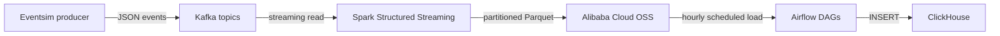

# Real-Time Music Data Pipeline

I built this project while following the `ankurchavda/streamify` project and adapting it to my own Ubuntu VM. The goal was to understand how a streaming data pipeline is connected end to end, rather than just getting each service to start.

The data is simulated, so “1 million users” refers to Eventsim's configured user population, not a production system that I benchmarked at one million concurrent real users.

## What the pipeline does

Eventsim generates mock music-app activity. Kafka receives the events, Spark Structured Streaming parses and transforms them, and the processed data is written to Alibaba Cloud OSS as Parquet files. Airflow is intended to load completed hourly partitions from OSS into ClickHouse, where I can run SQL queries.



The core path is:

`Eventsim → Kafka → Spark → OSS → Airflow → ClickHouse`

## Why these components are here

| Component | What I use it for | Port / detail |
|---|---|---|
| Zookeeper | Keeps coordination metadata for this Kafka setup. It is not a compute resource manager like YARN, although both are involved in coordinating distributed systems. | `2181` |
| Kafka broker | Buffers events between the producer and consumers, so Spark does not have to receive every event directly from Eventsim at the same speed. Kafka retention and consumer offsets help with recovery, but messages are not guaranteed to be kept forever unless retention and durability are configured accordingly. | `9092` from the VM host; container listeners may differ |
| Schema Registry | Stores and serves event schema definitions for producers and consumers that use it. It is not simply a general-purpose template folder. | `8081` |
| Control Center | Web UI for inspecting the Confluent Kafka environment. | `9021` |
| Spark Structured Streaming | Reads JSON messages from Kafka, converts them to typed DataFrames, derives time fields, and writes Parquet output. | Runs as Python/PySpark scripts |
| Alibaba Cloud OSS | Object storage for processed Parquet files, partitioned by event type and time. | Hangzhou endpoint configured through environment variables |
| Airflow | Schedules and tracks the hourly load tasks. A DAG expresses task dependencies; it is not just a drawing of the workflow. | Web UI on `8080` |
| ClickHouse | Column-oriented database for querying the loaded event records. | HTTP interface `8123`, native protocol commonly `9000` |

## Data formats along the way

- **Kafka JSON:** The producer sends event records as JSON messages. JSON is convenient for exchanging semi-structured events.
- **Spark DataFrame:** Spark parses the JSON with an explicit schema so downstream processing can work with typed columns.
- **Parquet on OSS:** Parquet is a columnar file format suited to storing processed data and reading selected columns later.
- **ClickHouse tables:** Airflow loads the selected data into tables for SQL queries.

## Event types

The current stream-processing scripts cover these topics:

- `listen_events`: listening activity
- `auth_events`: authentication events
- `page_view_events`: page views

Each stream has its own processing script and checkpoint location. Keeping checkpoint locations separate prevents the three queries from sharing streaming progress state.

## How I set it up

I used an Ubuntu VM under VMware and worked through the services in stages. That made it easier to tell whether a problem came from Docker, Kafka networking, Spark, OSS credentials, or Airflow.

1. **Install Docker Engine and Compose.** I use Compose to start the local services from their configuration files. The first setup issue was that Docker was missing; package installation also had to wait for an existing `apt` process to finish.
2. **Bring up Kafka and its supporting services.** The Compose stack includes Zookeeper, the broker, Schema Registry, and Control Center. One detail worth watching is the difference between host access (for example, `localhost:9092`) and container-to-container access (for example, `broker:29092`). Advertised listeners must match where the client is running.
3. **Start Eventsim.** The startup script builds the `events:1.0` image, then runs the `million_events` container with the example configuration and Kafka broker address. The user population and growth rate are simulation settings; they should not be treated as a measured throughput benchmark.
4. **Connect Spark to Kafka.** The PySpark scripts subscribe to the corresponding topics, parse the message `value` using the schemas in `spark_streaming/schema.py`, and transform `ts` into a timestamp before deriving `year`, `month`, `day`, and `hour`.
5. **Write processed data to OSS.** Spark writes Parquet files to an event-specific path and uses a separate checkpoint path to keep streaming progress. The current write trigger is configured in the processing scripts; the exact trigger interval is not a guarantee that every event is flushed to OSS at precisely that interval.
6. **Start ClickHouse and create the tables.** The SQL definitions are under `clickhouse/sql/init_table.sql`. Table columns include the event fields and time-partition fields used by the loader.
7. **Configure Airflow.** The custom image installs the Python libraries used by the DAGs. The root `.env` file supplies local credentials and connection settings; `.env.example` only documents the names and placeholder values.
8. **Schedule hourly loads.** The three DAGs call the shared `airflow/dags/hourly_loader.py` function for their respective event types. The intended behavior is to load the previous completed hour rather than whatever hour happens to be current when the task starts.

## Repository layout

```text
.
├── airflow/
│   ├── dags/
│   │   ├── hourly_loader.py
│   │   ├── load_auth_to_clickhouse.py
│   │   ├── load_listen_to_clickhouse.py
│   │   └── load_page_view_to_clickhouse.py
│   ├── Dockerfile
│   └── docker-compose.yaml
├── clickhouse/
│   ├── docker-compose.yaml
│   └── sql/init_table.sql
├── kafka/docker-compose.yml
├── spark_streaming/
│   ├── process_auth_events.py
│   ├── process_listen_events.py
│   ├── process_page_view_events.py
│   ├── schema.py
│   └── streaming_functions.py
├── .env.example
└── README.md
```

## Local configuration

Create a local environment file from the template:

```bash
cp .env.example .env
vim .env
```

Fill in your own values. Keep the real `.env` file out of Git. Do not put cloud access keys, ClickHouse passwords, Airflow credentials, or GitHub tokens in source files, screenshots, or commit messages.

The Spark scripts run on the VM host in my current setup, so they need host-reachable Kafka addresses. Services running inside a Compose network generally need the Compose service name and the container listener instead. Check each configuration before copying a broker address from one context to another.

## Useful checks

Check the local services:

```bash
docker compose ps
```

List Kafka topics from a container that has the Kafka CLI installed, using the broker address appropriate to that container. When testing ClickHouse, run a simple count query first:

```sql
SELECT count(*) FROM streamify.listen_events;
```

For the full pipeline, I check the stages in order: Kafka topics and messages, Spark logs, the OSS output prefix and Parquet objects, Airflow task logs, and finally ClickHouse row counts and timestamp ranges. Checking only that a container says `Up` does not prove the data is flowing through the complete pipeline.

## Things I learned / issues I ran into

- **Docker image downloads can fail independently of application configuration.** In this environment, Docker Hub and GitHub behaved differently under the network/proxy setup. I checked connectivity separately rather than assuming a failed `docker pull` meant the Compose file was wrong.
- **Host and container addresses are not interchangeable.** A broker address that works from the Ubuntu host may not work from another container. Kafka's advertised listeners need particular attention.
- **Kafka, Spark, and OSS are different stages.** Kafka stores and distributes the incoming stream; Spark does the parsing and transformation; OSS stores the processed files. They are not interchangeable forms of storage.
- **Airflow's schedule uses its configured timezone.** The previous-hour calculation must be consistent with the timezone used to derive Spark's `year/month/day/hour` partitions. In my test data, the OSS partition path and the timestamps read from a Parquet file appeared to differ by eight hours. That discrepancy still needs to be resolved before treating hourly loads as fully validated.
- **A DAG can be queued without a task completing.** A successful `airflow dags trigger` command means a run was created, not that the task finished. The scheduler, executor, DAG run, task state, and task logs all need to be checked.
- **A successful connection test is only one checkpoint.** I verified that ClickHouse was reachable and that tables existed, but this alone does not establish that every event is loaded into the correct hour without duplicates or gaps.

## Current status

The project has the main components and code organized in the repository. Kafka and ClickHouse were running during local checks, ClickHouse tables contained records, and the Airflow DAGs were importable. However, I still need to finish an end-to-end validation of the hourly Airflow load, especially the eight-hour timestamp/partition mismatch and the DAG run that remained queued.

For now, this is a learning project, not a production-ready pipeline. Before relying on the results, I need to verify timezone handling, failure recovery around ClickHouse deletes/inserts, and record counts across Kafka, OSS, and ClickHouse.

## Security notes

- Keep `.env` out of version control and use placeholders in `.env.example`.
- Rotate any access key or token that has been exposed.
- Use a restricted OSS policy rather than broad account permissions.
- Do not commit data dumps or credentials to demonstrate that the pipeline works.
